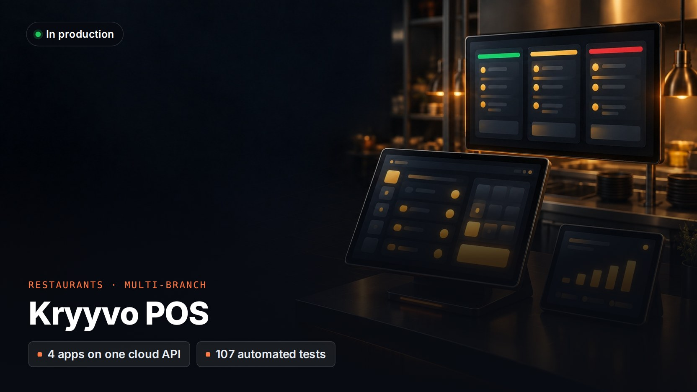

# Kryyvo POS

> **A multi-business, multi-branch restaurant and cafeteria platform on one cloud API.**
>
> This is a showcase repo. The source code is private and the client's name is withheld. A live demo or a code walkthrough is available on request.

**Client:** Restaurant and cafeteria businesses with several branches  
**My role:** Architecture, design and full-stack development through Kryyvo  
**Status:** In production, hardening phase

## The problem

One owner runs different kinds of food business: full-service restaurants that need a proper POS and kitchen workflow, and cafeterias that only need to record daily sales and customer credit (*udhar*). They wanted one system and one view across every branch.

## What I built

- **Restaurant POS for Windows (Electron).** PIN login, a menu grid, dine-in, takeaway and delivery orders, tax, and split payments.
- **Kitchen tickets** printed automatically to the right section's printer over the local network.
- **Kitchen display** in the browser over WebSocket, with colour-coded urgency and item-by-item status.
- **Day close** that locks the day, plus expenses, and voids that require a reason.
- **Cafeteria register app:** daily sales totals and customer credit accounts with a full ledger.
- **Owner dashboard:** KPIs, branch comparison, credit aging, and menu and user management.

## Engineering highlights

- Multi-tenant by design: every record is scoped to its business and branch, and the login token carries that scope.
- The POS works fully offline on a local SQLite database, syncing every 60 seconds with retries and duplicate protection.
- A dedicated reliability pass: failed records are quarantined instead of silently dropped, long backlogs drain automatically, and sync runs are serialised so rows are never uploaded twice.
- 107 automated tests, and CI runs type checks and tests on every pull request.

## Stack

| Layer | Technology |
|---|---|
| **POS** | Electron 33, React 18, Vite, Tailwind, Zustand, better-sqlite3 |
| **API** | Fastify 5, Prisma, PostgreSQL 16, Zod, JWT |
| **Infrastructure** | PM2 cluster, Nginx, Linux VPS, GitHub Actions |
| **Other apps** | Kitchen display, register and owner dashboard (React) |

---

[← More projects on my profile](https://github.com/husnainms) · Want a demo or a code walkthrough? Email [info@kryyvo.com](mailto:info@kryyvo.com).
